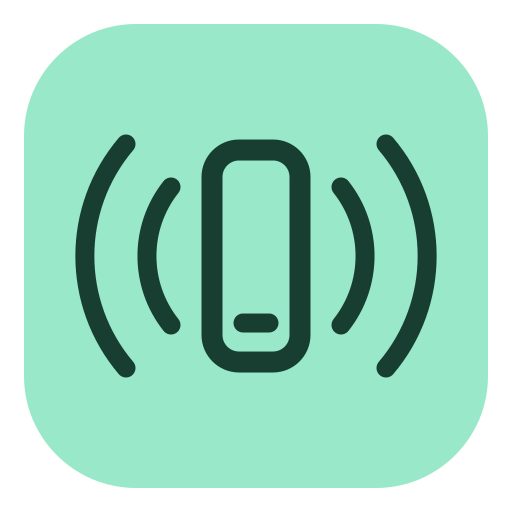

# Sim Relay

A graphical desktop client for iOS simulators running on another Mac. The Electron app runs
on macOS, Windows, and Linux. The Mac runs Xcode's actual iOS Simulator; clients receive its
framebuffer and send native input over an encrypted connection. No cloud account or physical
iPhone is required.

This is a working first version, **not yet complete parity with the native Mac Simulator**.
See the current limits below.

## Run the desktop app

Download a version from [GitHub Releases](https://github.com/Nailington/sim-relay/releases):
macOS DMG/ZIP (Apple Silicon or Intel), Windows EXE (x64 or arm64), or Linux AppImage,
tar.gz, DEB, or RPM (x64 or arm64). Releases become available after a version tag completes the release workflow.
Packaged apps include their runtime and do not require Node.js. Local packaging outputs
are written to `release/`.

For macOS installation, Homebrew, permissions, and Xcode host setup, follow the
[macOS guide](docs/macos.md). After the first stable release, install through Homebrew with:

```sh
brew tap nailington/sim-relay https://github.com/Nailington/sim-relay.git
brew install --cask nailington/sim-relay/sim-relay
```

To publish versions, see [CI and releases](docs/releasing.md), including
[Apple Developer signing setup](docs/macos.md#signing-releases-with-your-apple-developer-program-account).

On Debian/Ubuntu, install the downloaded DEB with `sudo apt install ./Sim-Relay-VERSION-linux-amd64.deb`.
On Fedora, use `sudo dnf install ./Sim-Relay-VERSION-linux-x86_64.rpm`. Replace `VERSION`
with the release version; ARM64 downloads use `arm64.deb` and `aarch64.rpm` respectively.
Both packages add **Sim Relay** to the desktop app menu.

To run from source instead:

Install Node.js 24, then from this checkout:

```sh
npm ci
npm run dev
```

`npm run dev` opens an Electron window and starts its UI development server. `npm run dev:ui`
opens only the browser preview, which uses clearly labeled, simulated demo data. Real
connections run through Electron's isolated native bridge and are unavailable in the browser.

## Install with Nix

The flake provides `packages.<system>.default` (also named `sim-relay`),
`apps.<system>.default`, `overlays.default`, and `devShells.<system>.default` for
x86_64/aarch64 Linux and aarch64 macOS. It builds from the npm lockfile and uses nixpkgs' Electron
runtime. The Linux package includes a desktop menu entry; the macOS package includes
`Applications/Sim Relay.app`. Nix builds are verified on x86_64 Linux; the other Nix targets
still need native build/runtime validation. The pinned nixpkgs no longer supports Intel macOS.

Add the GitHub repository as an input to your flake:

```nix
inputs.sim-relay.url = "github:Nailington/sim-relay";
```

Then include the package in a NixOS module (with `inputs` passed through `specialArgs`):

```nix
{ inputs, pkgs, ... }:
{
  environment.systemPackages = [
    inputs.sim-relay.packages.${pkgs.stdenv.hostPlatform.system}.default
  ];
}
```

For Home Manager, use the same package in `home.packages` and pass `inputs` through
`extraSpecialArgs`. Alternatively, add `inputs.sim-relay.overlays.default` to
`nixpkgs.overlays` and install `pkgs.sim-relay`. The overlay uses your nixpkgs; the direct
package uses this project's pinned nixpkgs. You may set
`inputs.sim-relay.inputs.nixpkgs.follows = "nixpkgs"` to share your pin, provided it has
Electron 43 or newer and Node.js 24.

Build or launch directly from GitHub without installing:

```sh
nix build github:Nailington/sim-relay
nix run github:Nailington/sim-relay
# On a Mac with Xcode and idb_companion installed:
./result/bin/sim-relay-host
```

The host still requires the Mac setup below; Nix does not install Xcode or iOS runtimes.
For development in a local checkout, run `nix develop .`, then `npm ci` and `npm run dev`.
The shell uses Nix's Electron rather than downloading another runtime.

After changing `package-lock.json`, update `npmDepsHash` in `nix/package.nix`: set it to
`lib.fakeHash`, run `nix build .`, and replace it with the reported `got: sha256-…`
hash. `nix flake check .` type-checks and builds the package.

## Set up the Mac

The tested host is Apple Silicon, macOS 15.7.1, Xcode 26.0.1, iOS 26.0, and `idb_companion` 1.7.7.
Install Xcode, open it to finish setup, and install an iOS runtime under **Xcode → Settings →
Components**. Select that Xcode installation with `xcode-select` if needed.

Install the native input and video dependency:

```sh
brew tap facebook/fb
brew install idb-companion
```

Use a recent companion with pinch, shake, and orientation support. The current companion
requires compatible macOS and Xcode versions; older Intel/Xcode combinations are unverified.
The host searches `/opt/homebrew/bin`, `/usr/local/bin`, and `PATH`. Set `IDB_COMPANION_PATH` for
a custom installation.

In the desktop app on the Mac, select **Set up a Mac host → Start sharing**. Alternatively,
start the bundled command from Terminal:

```sh
sim-relay-host
```

Homebrew installs this command automatically. For a DMG/ZIP install, choose **Sim Relay →
Install host command…** once in the app menu. No separate Node.js installation or source
checkout is needed. See the [macOS guide](docs/macos.md) for details. Source developers can
still use `npm ci` followed by `npm run host`.

To keep sharing after closing Terminal, use `sim-relay-host start`. It runs in the
background and starts again at login. Use `sim-relay-host status` for pairing details,
`sim-relay-host logs` for recent output, and `sim-relay-host stop` to stop sharing and
disable starting at login. See [background host setup](docs/macos.md#run-the-host-in-the-background).

Keep the Mac awake and the host running. It shows its address, pairing token, SHA-256
certificate fingerprint, and dependency readiness. Allow incoming connections through the
Mac's firewall for LAN access. Default port: TCP **49300**. Discovery uses Bonjour/mDNS.
On macOS, allow Local Network access when requested; see [Apple’s local network privacy guide](https://developer.apple.com/documentation/technotes/tn3179-understanding-local-network-privacy).

On the client, choose a nearby Mac or **Connect a Mac**, enter its address, compare the
fingerprint with the Mac, and enter its pairing token. Pick an existing simulator or create
one with an installed runtime, then select **Start & connect**.

## Local and direct connections

Wi-Fi, Ethernet, directly connected Ethernet adapters, Thunderbolt networking, and other
routable IP connections use the same HTTPS endpoint. Discovery is optional: enter an IP address
when mDNS is blocked. USB cables without an IP network interface are not supported.

SSH tunnels also work, including with Windows OpenSSH. On the Mac:

```sh
SIM_RELAY_BIND=127.0.0.1 sim-relay-host
```

On the client, keep this tunnel open:

```sh
ssh -N -L 49300:127.0.0.1:49300 user@your-mac
```

Connect to `https://127.0.0.1:49300` using the same Mac fingerprint and token. Loopback-only
hosts are not advertised through Bonjour.

## Controls

- Click, double-click, drag, and click-and-hold send native touch input. Coordinates map to
  simulator points independently of stream pixel resolution. Focus loss/disconnect releases
  held contacts and keys.
- Click the display to type. Letters, modifiers, navigation, and function keys use USB HID.
- **Alt + drag** or **Ctrl + scroll** performs a two-finger pinch. The wheel scrolls using
  native swipes. Pinch is sent as a completed gesture.
- The inspector provides Home, Lock, rotation, shake, volume, PNG screenshots, appearance,
  deep links, location, and **Paste text**. Paste text uses the simulator clipboard and
  Command+V, including Unicode; focus an iOS text field first.
- **Install app** transfers a ZIP containing one simulator `.app` from any client OS.
  Build for the simulator, not a physical device. On a Mac, create an archive with
  `ditto -c -k --keepParent MyApp.app MyApp.app.zip`. Limits: 128 MB compressed, 512 MB expanded,
  20,000 files. Archive symlinks become regular files. Install bundles that require symlinks
  directly from the Mac filesystem using the command panel.
- **Command panel** (Ctrl+K / Cmd+K) runs `simctl` arguments directly, without a shell.
  `$DEVICE` means the selected simulator. Launch/uninstall apps, send notifications, change
  permissions, import media, or use other finite `simctl` operations. Paths refer to the Mac.
  Erase/delete commands require a checkbox. Commands time out after two minutes.
- `/` focuses simulator search when outside text fields and the simulator display.

Each simulator permits one controlling client at a time. Separate simulators can have separate
clients. Disconnecting leaves the simulator running; **Shut down simulator** powers it off.

## Current limits

- Arbitrary simultaneous multi-finger paths, two-finger twist/rotation gestures, pressure,
  and stylus input are not implemented. The public idb streaming protocol used here exposes
  single-contact input and a predefined pinch. Device orientation rotation is supported.
- Streaming uses full-resolution MJPEG over TLS, requested 15/30/60 fps, frame dropping under
  backpressure, and actual decoded-frame measurements. H.264/WebRTC, adaptive bitrate, audio,
  recording controls, and guaranteed 60 fps are not implemented. MJPEG uses more bandwidth
  than an inter-frame video codec.
- Simulator-specific GUI menus, full Mac desktop control, Xcode editing/building/debugging,
  physical-device features, and long-running console sessions are outside this version.
- Intel hosts, Windows desktop behavior, signing, and notarization need platform validation.
  Linux and macOS Electron clients have both decoded real simulator video from the Mac host.
  Windows installer generation passes; its runtime still needs a Windows machine.
  Windows/macOS installer targets and a CI build matrix are configured.

## Security and storage

The host uses TLS, a persistent certificate, and a random single-use pairing code. Pairing verifies
the fingerprint before exchanging the code for a separate random 256-bit client credential.
The code changes after every successful pairing. The host stores only credential hashes;
the desktop client protects its credential with the OS credential store when available.
Subsequent HTTPS/WebSocket traffic validates the
pinned certificate. The companion uses a private Unix socket, not an exposed gRPC port.
Browser origins are rejected. The renderer has no Node integration or unrestricted IPC.

Manage access locally on the Mac with `sim-relay-host clients`,
`sim-relay-host revoke CLIENT_ID`, and `sim-relay-host pairing` (or `npm run host -- clients`
when running from source). Revoking a client closes its active displays and prevents reuse of
its credential; other clients stay connected. Use the same `SIM_RELAY_STATE_DIR` as the host.
See [client authorization](docs/client-authorization.md) for migration, desktop-host paths,
and the local administrator interface.

HTTPS works with local and Tailscale IP addresses: each Mac generates its own self-signed
certificate, so it does not need a public domain or a certificate authority. A browser may
warn about that certificate; Sim Relay pairs by comparing its fingerprint on both devices.
Connection compatibility uses an API protocol version independently of the app release
number. New hosts use protocol 2 for individual client authorization. Updated clients can
also connect to protocol 1 hosts, including releases `0.1.0` through `0.1.3`, which advertised
only an app version. Upgrading a host invalidates existing shared-token pairings; update
clients and pair them again. Protocol 1 hosts retain their original shared-token behavior.

Pairing grants simulator management access as the Mac user, including simulator commands.
Give the token only to trusted clients. Saved client tokens use operating-system encryption.
Without secure storage, pairing stays in memory for that session; plaintext persistence is disabled.

CLI host state lives in `~/.sim-relay`; desktop host state lives under Electron's user-data
directory. To revoke paired clients, stop sharing and remove the host's `token` file; starting
again generates a new token. Replacing the host certificate requires pairing again.

Host variables: `SIM_RELAY_PORT`, `SIM_RELAY_BIND`, `SIM_RELAY_STATE_DIR`, `IDB_COMPANION_PATH`.
Clients do not need Xcode or idb.

## Build and verify

```sh
npm run check
npm run build
npm run package:dir
npm run package
```

Build installers on their target OS. Outputs go to `release/`: macOS DMG/ZIP, Windows NSIS,
Linux AppImage/tar.gz/DEB/RPM. CI type-checks and builds native packages for six targets,
and keeps the Nix flake checked. Version tags publish a GitHub Release with checksums;
stable releases also update the Homebrew cask. Signing and notarization are enabled with
repository secrets and explicit signing variables. See [CI and releases](docs/releasing.md).

CI inspects Linux package metadata and payloads. Releases require every expected installer
and include SHA-256 checksums. Local test suites and test runners are excluded from the
published source and Nix package inputs.

## Implementation

- `src/electron`: native window, discovery, encrypted profiles, pinned transport, file pickers,
  and restricted preload bridge.
- `src/host`: HTTPS/WebSocket service, `simctl`, app installation, and per-session companion
  processes. Completed gestures drain their own HID RPC on a persistent companion connection.
- `src/renderer`: React workspace/dialogs, canvas video, keyboard/touch mapping, labeled demo.
- `scripts`: development builds, package validation, and release automation.

See [THIRD_PARTY_NOTICES.md](THIRD_PARTY_NOTICES.md) for protocol licensing.

For independent display windows, automatic recovery, gesture capabilities, and platform validation notes, see [Display sessions](docs/display-sessions.md).
